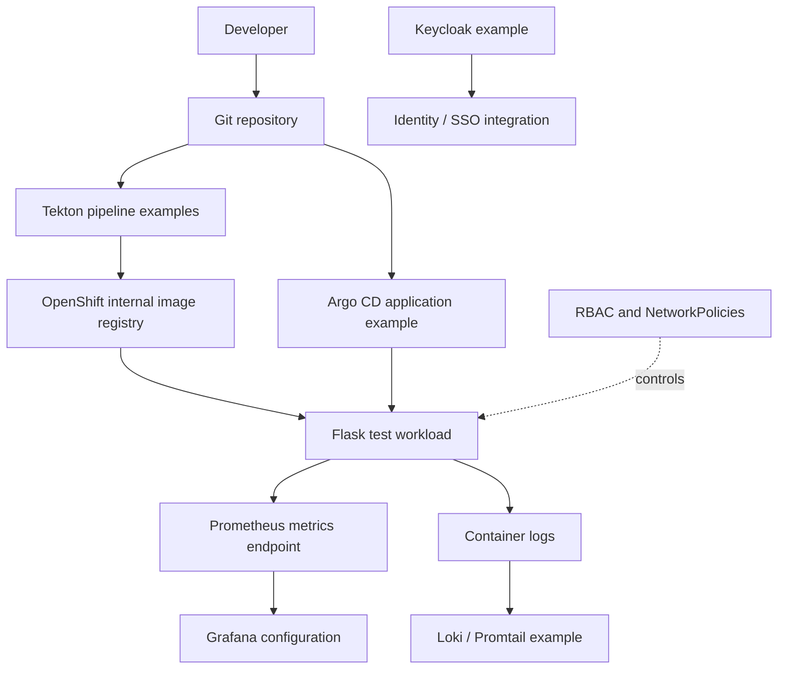

# OpenShift DevSecOps Security Lab

A personal hands-on lab for exploring application delivery and platform security on OpenShift. The repository combines an intentionally vulnerable Flask workload with OpenShift/Kubernetes manifests and examples for CI/CD, GitOps, identity, monitoring, and logging.

> **Lab only:** this repository is not a production-ready reference architecture. The Flask application is deliberately vulnerable. Run it only in an isolated, disposable environment and never expose it to the public internet.

## Project goals

- Deploy and manage containerized workloads on OpenShift.
- Explore CI/CD workflows with Tekton and image-building tasks.
- Demonstrate declarative delivery with Argo CD.
- Apply namespace-scoped RBAC and NetworkPolicies.
- Explore centralized identity with Keycloak.
- Collect application metrics and logs using Prometheus-compatible monitoring and Loki/Promtail.

## Architecture at a glance



The diagram describes the intended relationships between repository components; it is not evidence that every integration is currently deployed or validated end-to-end.

## Repository map

| Path | Purpose |
|---|---|
| `application/vulnerable-app/` | Deliberately vulnerable Flask test application, image build and deployment resources |
| `application/vulnerable-app/tests/` | Basic HTTP integration checks and security-lab checks |
| `scenarios/scenario1-rbac/` | Namespace roles, role bindings and NetworkPolicies |
| `scenarios/scenario2-pipeline/` | Tekton tasks, pipeline and trigger examples |
| `scenarios/scenario3-sonarqube/` | SonarQube deployment and scanner task example |
| `scenarios/scenario4-nexus/` | Nexus deployment and repository task example |
| `scenarios/scenario5-gitops/` | Argo CD Application example |
| `scenarios/scenario6-monitoring/` | ServiceMonitor, PrometheusRule and Grafana configuration |
| `scenarios/scenario7-logging/` | Loki and Promtail configuration |
| `scenarios/scenario8-keycloak/` | Keycloak, PostgreSQL and realm configuration |
| `scenarios/scenario9-linkerd/` | Linkerd notes and service-mesh configuration examples |
| `scenarios/scenario10-fullpipeline/` | Extended Tekton pipeline example |
| `setup/` | Namespace quotas, LimitRanges, monitoring and RBAC setup |
| `scripts/` | Deployment, cleanup, diagnostics and scenario helper scripts |

## Implementation status and limitations

The repository contains manifests and examples for the components below. A manifest being present does **not** by itself prove that the component was successfully deployed or integrated in a running cluster.

| Area | What is in the repository | Status / qualification |
|---|---|---|
| OpenShift workload | Flask app, ImageStream, BuildConfig, Deployment, Service and Route | Lab workload; validate against your target OpenShift version |
| RBAC | Developer, operator and auditor roles and bindings | Configuration example; review permissions before applying |
| Network security | Ingress and egress NetworkPolicies | Requires a CNI that enforces NetworkPolicy; validate selectors and required traffic |
| Tekton | Build/deploy pipelines, triggers and supporting tasks | Examples are version-sensitive; validate task availability and service-account permissions |
| GitOps | Argo CD Application manifest | Replace repository URL/revision and verify the destination project/namespace |
| Keycloak | Keycloak and PostgreSQL resources plus realm import data | Lab configuration; provide credentials separately and validate the OpenShift OAuth/client integration |
| Monitoring | ServiceMonitor, PrometheusRule and Grafana datasource/dashboard examples | Requires compatible user-workload monitoring and the relevant operators |
| Logging | Loki and Promtail manifests | Lab example; permissions, host log access and compatibility need cluster validation |
| SonarQube / Nexus | Deployment and task examples | Optional components; resource-heavy for a small local cluster |
| Linkerd | Installation notes and injection instructions | **Documentation/prototype only**; do not describe this as a deployed service mesh unless you validate it yourself |

This lab was developed for a local CodeReady Containers (CRC) / OpenShift Local environment with limited laptop resources. It is single-node and does not demonstrate production high availability, multi-node failure recovery, or production-scale performance.

## Prerequisites

- A working OpenShift Local / CRC environment, started and authenticated.
- `oc` CLI compatible with the cluster.
- `tkn` only if you intend to run the Tekton examples.
- Permission to create namespaces, workloads, routes, roles and monitoring resources.
- Sufficient local CPU, memory and disk. Optional SonarQube and Nexus deployments can be resource-intensive.

Check cluster access:

```bash
oc whoami
oc get nodes
oc version
```

## Basic application deployment

From the repository root:

```bash
oc apply -f setup/namespaces/namespaces.yaml
oc project security-demo
./scripts/deploy-app.sh
```

The deployment script builds the application from the local source using the OpenShift BuildConfig and waits for the Deployment rollout. It prints the generated Route URL.

Because this is an intentionally vulnerable workload, keep it inside an isolated local lab. Do not configure public DNS, external ingress, or production data for it.

## Keycloak lab setup

The Keycloak deployment expects two Secrets to exist in the `security-tools` namespace. Follow [Security and configuration notes](docs/SECURITY.md) to create local database and admin credentials before applying `scenarios/scenario8-keycloak/deployment.yaml`.

The realm file contains demo identities without committed passwords. Set credentials through the Keycloak administration interface after importing the realm.

## Tests

The repository includes basic HTTP checks in `application/vulnerable-app/tests/integration-tests.yaml` and security-lab checks in `application/vulnerable-app/tests/security-tests.yaml`.

Apply and inspect them only after the application is running:

```bash
oc apply -f application/vulnerable-app/tests/integration-tests.yaml
oc logs job/integration-test -n security-demo
```

The security test job exercises the deliberately vulnerable test application. It is not a security certification or a substitute for a proper application security test suite.

Tekton task and pipeline manifests are examples, not a guarantee of a fully automated, passing CI/CD workflow. Confirm that referenced ClusterTasks, Tekton API versions, credentials, workspaces and image registry permissions exist in your cluster before running them.

## Security notes

- The Flask app intentionally includes SQL injection, cross-site scripting, command injection and information-disclosure examples. These are test cases, not recommended application patterns.
- Do not use real credentials or real personal data in the lab.
- Keycloak, PostgreSQL and Nexus must use credentials supplied outside the repository. See [Security and configuration notes](docs/SECURITY.md).
- Review RBAC permissions and NetworkPolicy behavior before applying manifests to any shared cluster.
- The demo Route is not a production exposure pattern. Keep the lab isolated.
- Pin container images to reviewed versions or digests before using these examples beyond a disposable lab.
- Do not treat a Trivy/SonarQube task manifest as proof that scans are enforced; inspect task exit behavior and pipeline results.

## What I would validate next

1. Apply the base namespaces and workload on a clean CRC instance.
2. Verify the application build and rollout, then run the HTTP integration checks.
3. Test RBAC with `oc auth can-i` for each service account.
4. Verify NetworkPolicy behavior with allowed and denied test traffic.
5. Run each Tekton pipeline independently and confirm that failures stop the pipeline.
6. Validate Keycloak login/SSO against the intended OpenShift OAuth configuration.
7. Capture real screenshots and command output for successful deployments and monitoring.

## Scope

This is an educational portfolio project showing practical exploration of OpenShift, Kubernetes, DevSecOps, CI/CD, GitOps, platform security and observability. It is intentionally transparent about the difference between implemented manifests, examples, and integrations that still require validation.
